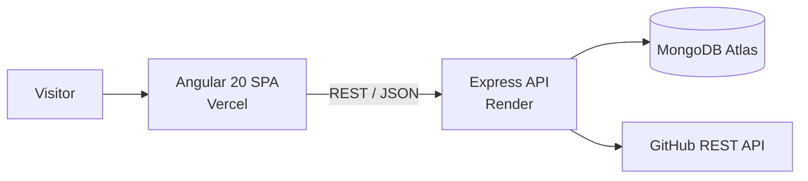

<div align="center">

# Moaz Ali | Full Stack Portfolio

**A production-grade, bilingual portfolio built with Angular 20, Tailwind CSS and a Node.js / Express / MongoDB API.**
Content (projects, experience, blog) is served from a REST API, so the site stays live without a redeploy.

[](https://moaz-ali-portfolio.vercel.app)


</div>

---

## Overview

This repository is the source of my personal portfolio, **moaz-ali-portfolio.vercel.app**. It is built the way I build client work: typed end to end, component-driven, accessible, responsive and deployable.

- **Frontend:** Angular 20 single-page app using standalone components, signals and `OnPush` change detection.
- **Backend:** Express REST API with Mongoose models, JWT-protected write routes and rate limiting.
- **Content-driven:** projects, experience and blog posts live in MongoDB and are rendered from the API.
- **Bilingual:** English and Urdu (RTL) with a key-based translation service.

## Highlights

| Area | What it does |
|---|---|
| **Pages** | Home, About, Skills, Projects, Experience, Blog and Contact, each lazy-loaded. |
| **Case studies** | Project and experience detail pages with role, challenge, solution, key features and next/previous navigation. |
| **Blog** | Post list and article pages with a built-in body parser (headings, fenced code blocks), table of contents, estimated read time, share and copy-link actions. |
| **Image carousel** | Swipeable project gallery built on native scroll-snap (no library): arrows, dots, keyboard and touch support. |
| **Theming** | Dark by default with a persisted light mode, applied before first paint to avoid a flash. |
| **i18n** | English / اردو switch, with `lang` and `dir` updated on the document (full RTL layout). |
| **Motion** | Scroll-reveal, skills marquee, floating hero card. All of it respects `prefers-reduced-motion`. |
| **Contact** | Reactive form with per-field validation, SweetAlert2 feedback, newsletter subscription and resume download. |
| **Accessibility** | Skip link, landmark roles, labelled controls, focus-visible styles, `aria-live` and `aria-current` where it matters. |

## Tech stack

| Layer | Technologies |
|---|---|
| **Frontend** | Angular 20, TypeScript, RxJS, Signals, Reactive Forms, Angular Router (lazy routes, component input binding) |
| **Styling** | Tailwind CSS 3.4 with CSS-variable design tokens (dark and light palettes), custom keyframe animations |
| **Backend** | Node.js, Express, Mongoose, JWT authentication, `express-rate-limit`, CORS allow-list |
| **Database** | MongoDB (Atlas) |
| **Integrations** | GitHub REST API (repositories and READMEs), SweetAlert2 |
| **Tooling** | Angular CLI, Prettier, Karma and Jasmine |
| **Hosting** | Vercel (frontend), Render (API) |

## Architecture



**Request flow:** the SPA calls the API through a single typed `ApiService`. Pages render a uniform `loading → ready → error` state, so every list and detail view handles slow networks and failures the same way.

## Engineering decisions

- **Design tokens, not magic colors.** Colors are CSS variables mapped into `tailwind.config.js`, so dark and light themes share one set of utility classes.
- **Reusable building blocks.** `appButton`, `appCard` and `appReveal` directives plus chip, section-header, marquee and carousel components keep pages short and visually consistent.
- **One page, many contexts.** `About` and `Projects` are the same components on their own routes and as sections on Home, switched by route data.
- **Signals and `OnPush` everywhere.** State is held in signals and derived with `computed`, which keeps rendering predictable and cheap.
- **No animation library.** Reveal, marquee and carousel use CSS and `IntersectionObserver`; reduced-motion users still see every item.
- **Typed API contract.** Models and `Observable` return types live next to the service; detail pages bind the route `:slug` straight into a component `input`.
- **Content without redeploys.** Write routes are JWT-protected, and idempotent seed scripts (`upsert` by slug) populate or refresh data safely.

## API reference

Base URL (local): `http://localhost:3000/api`

| Method | Endpoint | Description | Auth |
|---|---|---|:---:|
| GET | `/health` | Service health check | – |
| GET | `/projects?featured=true&limit=3` | List projects (optional filters) | – |
| GET | `/projects/:slug` | Project with case study | – |
| GET | `/experience` | List experience | – |
| GET | `/experience/experience-details/:slug` | Experience detail | – |
| GET | `/blog` | List blog posts | – |
| GET | `/blog/:slug` | Blog post | – |
| GET | `/github/repos` | Public repositories | – |
| GET | `/github/repo/:owner/:repo/readme` | Repository README | – |
| POST | `/contact` | Send a contact message | – |
| POST | `/newsletter` | Subscribe to the newsletter | – |
| GET | `/upload/resume` | Download the resume | – |
| POST / PUT / DELETE | `/projects`, `/experience`, `/blog` | Create, update, delete content | JWT |

## Getting started

### Prerequisites

- Node.js **20.19+** and npm
- A MongoDB database (local or Atlas)

### 1. Clone

```bash
git clone https://github.com/Moazali302/Muaz_Portfolio.git
cd Muaz_Portfolio
```

### 2. Backend

```bash
cd backend
npm install
```

Create `backend/.env` (see [Environment variables](#environment-variables)), then seed some content and start the API:

```bash
node scripts/seed-projects.js
npm run start        # http://localhost:3000
```

### 3. Frontend

```bash
cd frontend/portfolio-app
npm install
npm start            # http://localhost:4202
```

The dev API URL is configured in `src/environments/environment.ts`.

### Useful commands

| Where | Command | Purpose |
|---|---|---|
| `frontend/portfolio-app` | `npm start` | Dev server on port 4202 |
| `frontend/portfolio-app` | `npm run build` | Production build |
| `frontend/portfolio-app` | `npm test` | Unit tests (Karma and Jasmine) |
| `backend` | `npm run start` | Start the API |
| `backend` | `node scripts/seed-projects.js` | Seed or refresh projects (idempotent) |

## Environment variables

**Backend** (`backend/.env`)

| Variable | Description |
|---|---|
| `PORT` | API port (default `3000`) |
| `MONGODB_URI` | MongoDB connection string |
| `FRONTEND_URL` | Deployed frontend origin allowed by CORS (`http://localhost:4202` is allowed by default) |

**Frontend**

| File | Key | Description |
|---|---|---|
| `src/environments/environment.ts` | `apiUrl` | API base URL for development |
| `src/environments/environment.prod.ts` | `apiUrl` | API base URL for production |

## Deployment

| Part | Platform | Settings |
|---|---|---|
| Frontend | Vercel | Root `frontend/portfolio-app`, build `npm run build`, output `dist/portfolio-app/browser`, SPA fallback to `index.html` |
| API | Render | Root `backend`, start `node server.js`, set the environment variables above |

Add the Vercel domain to `FRONTEND_URL` on Render so CORS allows it.

## Project structure

```text
Muaz_Portfolio/
├─ backend/
│  ├─ middleware/        # JWT auth
│  ├─ models/            # Mongoose models (project, experience, blog, ...)
│  ├─ routes/            # auth, github, blog, experience, projects, contact, upload, newsletter
│  ├─ scripts/           # idempotent seed scripts, sitemap generator
│  └─ server.js
└─ frontend/portfolio-app/
   ├─ public/            # static files
   └─ src/
      ├─ app/
      │  ├─ components/       # route pages: home, about, skills, projects, experience, blog, contact
      │  ├─ guards/services/  # api, translate and theme services
      │  └─ shared/
      │     ├─ config/        # nav links, site info, skills
      │     ├─ directives/    # appButton, appCard, appReveal
      │     ├─ ui/            # chip, section header, marquee, image carousel
      │     ├─ components/    # project card
      │     └─ utils/         # load-state, blog body parser, neighbours, helpers
      ├─ assets/              # images and project screenshots
      ├─ environments/
      └─ styles.css           # design tokens and global styles
```

## Roadmap

- [ ] Angular SSR / prerendering for stronger SEO and faster first paint
- [ ] CI pipeline (GitHub Actions): lint, unit tests and build on every pull request
- [ ] End-to-end tests with Playwright for the critical flows
- [ ] Image optimization pipeline (WebP and responsive sizes)

## Contact

**Moaz Ali**, Full Stack Developer (Angular, NestJS, Node.js)

- Portfolio: [moaz-ali-portfolio.vercel.app](https://moaz-ali-portfolio.vercel.app)
- GitHub: [@Moazali302](https://github.com/Moazali302)
- LinkedIn: [moaz-ali-4710ba397](https://www.linkedin.com/in/moaz-ali-4710ba397/)
- Email: [moazj049@gmail.com](mailto:moazj049@gmail.com)

I am open to freelance and full-time opportunities. Feel free to reach out.

## License

Released under the [MIT License](LICENSE). Copyright (c) 2026 Moaz Ali.